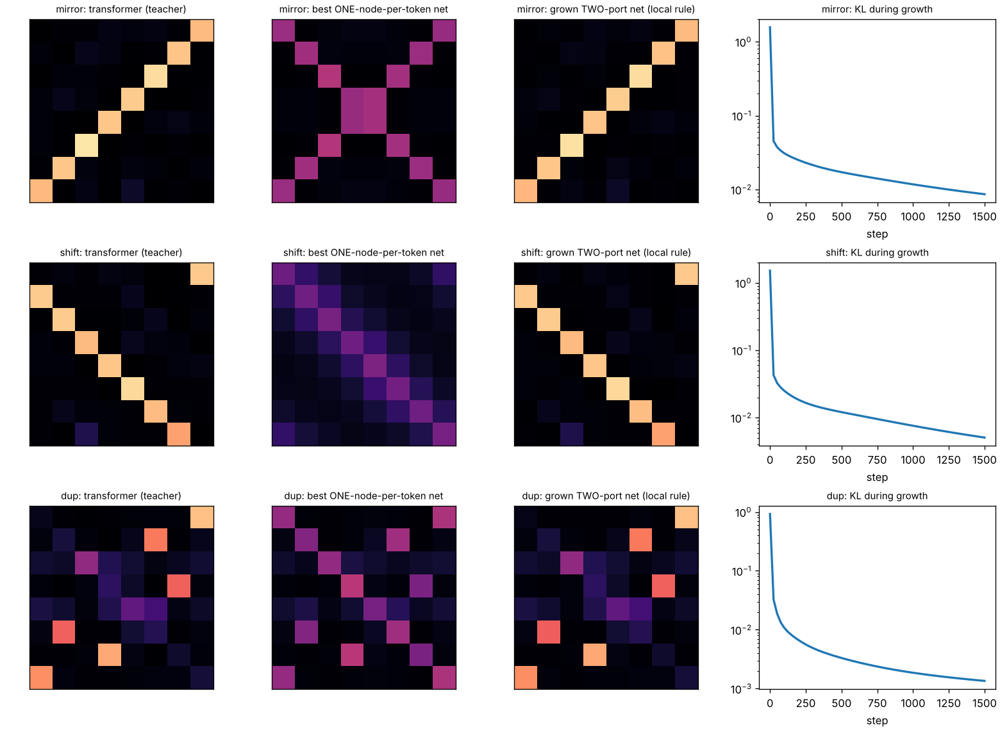

# Limasieni — can a slime mold grow a transformer's attention?



*Limasieni* is Finnish for slime mold.

A tiny transformer is trained on three toy tasks. A *Physarum*-style flow network
(tubes that carry current and adapt their conductance) is then asked to produce the
same attention matrix. One layout grows it from a uniform mesh with a purely local
rule and the transformer still answers correctly with the grown matrix. The classic
layout provably cannot, and the reason is two theorems about electrical networks.

Toy scale: 8 tokens, vocabulary 8, one attention head. Numpy + autograd, CPU only.

```
pip install numpy scipy matplotlib autograd
python g1_train_teacher.py     # train the teacher transformers (~6 min)
python g2_fit_layouts.py       # how well can each network layout copy the matrix?
python g4_grow.py              # grow the two-port network with the local rule
python g6_anneal.py            # unsupervised Physarum on the transformer's attention
python g5_end_to_end.py single 600 2   # train the transformer WITH slime attention
python make_figures.py
python gui.py                  # watch it grow
python -m unittest discover -s tests -v
```

## The one identity

Inject one unit of current at a node that is connected to grounded nodes through
parallel conductances `C_j`. Current divides in proportion to conductance:
`I_j = C_j / sum_k C_k`. With `C_j = exp(q·k_j / sqrt(d))` that is exactly softmax.

**Softmax attention is current division.** A query is a food source, each key is a
grounded sink, and the attention weights are the fraction of the food that reaches
each sink. `test_softmax_is_grounded_current_division` checks it to 1e-7 (the gap
scales as 1/g with the sink conductance g). The identity is elementary; the
experiments are about what follows from it.

## Two layouts

**Two-port** (`two_port_attention`): every token owns a *query port* (food source,
no sink) and a *key port* (drains to ground through sink `g`). Tubes `C_ij` connect
query `i` to key `j`.

**Single graph** (`single_graph_attention`): the classic Physarum picture. One node per
token, and that node is both where food is injected and where it is consumed.
`A = (L + G)^-1 G`, with `L` the tube Laplacian and `G = diag(g)`. A *valves* variant
allows one-way tubes (non-symmetric `L`, an absorbing random walk).

### Why the single graph cannot be attention

For reciprocal (symmetric) tubes, `K = (L+G)^-1` is symmetric, so:

1. **Detailed balance**: `g_i A_ij = g_j A_ji`. The network can only produce
   *reversible* matrices. Measured by the entropy production
   `sigma = sum pi_i A_ij log(pi_i A_ij / pi_j A_ji)`, zero iff reversible.
2. **Maximum principle**: the potential from a unit injection at `i` is highest at
   `i`, so `K_ii >= K_ij`. After reweighting by the stationary distribution, current
   always leaves *preferentially where it entered*. A head that looks away from its
   own token is forbidden.

Both facts are standard (reversible Markov chains; discrete harmonic functions).
The new part here is measuring them on a trained transformer's heads.

## Results

### G1 — teacher transformer (softmax)
Held-out accuracy 1.000 on all three tasks.

| task | what the head learned |
|---|---|
| mirror `y_i = x_{n-1-i}` | a near-permutation onto the reflected position |
| shift `y_i = x_{i-1}` | a directed cycle onto the previous position |
| dup `y_i = 1 if x_i occurs elsewhere` | attend to the *other* copy of your token; diffuse if you have none |

### G2/G3 — best possible copy of the teacher's matrix (exact L-BFGS fit, 24 inputs each)

KL(teacher ‖ network), lower is better. Uniform attention scores 1.48 / 1.40 / 0.67.

| task | sigma (irreversibility) | rows violating max principle | single graph | valves | two-port |
|---|---|---|---|---|---|
| mirror | 0.012 | 100% | 0.607 | 0.606 | 0.0002 |
| shift | 3.156 | 100% | 1.201 | 0.989 | 0.0001 |
| dup | 0.012 | 62% | 0.158 | 0.155 | 0.00003 |

- Mirror and dup are nearly reversible but still fail, so the **maximum principle** is
  the binding constraint. The best single-graph copy of mirror splits each row roughly evenly
  between the token itself and its mirror partner: the two nodes get shorted together.
- One-way valves barely help (shift 1.20 → 0.99, mirror unchanged). The obstruction
  is a node having to be both the place current enters and the place it leaves. That
  is the physical reason attention needs separate query and key roles.
- The two-port layout copies all three essentially exactly.

### G4 — growing the two-port network with a local rule

Start: every tube equal. Rule, per tube, using only that tube's own pressure drop:

```
free   : food injected at one query, flow settles
nudged : same, plus a weak pull (beta) of each key sink toward the teacher's uptake
dlogC  = lr * [ dv_free^2 - dv_nudged^2 ] / (2 beta)     summed over the 8 food sources
```

This is equilibrium propagation / coupled learning for a resistor network (Scellier &
Bengio 2017; Kendall et al. 2020; Stern et al. 2021). It matches the exact gradient of
the squared uptake error with cosine 0.99999 (`test_local_rule_is_the_gradient`).

| task | KL local rule | KL exact gradient | transformer accuracy with GROWN matrix | with uniform matrix | tubes pruned below 1% |
|---|---|---|---|---|---|
| mirror | 0.0055 | 0.0055 | **1.000** | 0.302 | 88% |
| shift | 0.0042 | 0.0042 | **1.000** | 0.344 | 88% |
| dup | 0.0032 | 0.0033 | **1.000** | 0.396 | 50% |

12 held-out inputs per task, 1500 growth steps. "Accuracy with grown matrix" replaces
the transformer's own attention by the slime network's current split for that input
and runs the rest of the trained transformer unchanged.

### G6 — unsupervised Physarum on the transformer's own attention

The Tero et al. adaptation rule in its power-law form, `dC/dt = |Q|^mu - C`, on a grounded two-port network, started from the
teacher's attention (100 inputs per task):

| mu | regime | mirror | shift | dup |
|---|---|---|---|---|
| 0.7 | loops, flattens to uniform | 0.295 | 0.309 | 0.376 |
| 1.0 | every attention matrix is a fixed point | 1.000 | 1.000 | 1.000 |
| 1.5 | trees, hardens to argmax | 1.000 | 1.000 | 0.649 |

Softmax attention is a neutral fixed point of Physarum adaptation. The tree regime
keeps pointer tasks (mirror, shift) intact and breaks the task that needs soft,
superposed attention (dup).

### G5 — slime attention trained inside the transformer, end to end

| attention inside the transformer | mirror | shift | dup |
|---|---|---|---|
| softmax (teacher, 1200 steps) | 1.000 | 1.000 | 1.000 |
| two-port network (600 steps, 1 seed) | 1.000 | 1.000 | 1.000 |
| single graph (seeds 1, 2) | 1.000, 1.000 (1200 steps) | 0.743, 0.875 at 600 steps; 0.972 at 2500 steps (seed 1) | 0.999, 0.993 (600 steps) |

Held-out accuracy on 512 sequences. The physics forbids the single graph from *copying*
the teacher's matrix, but it does not stop the transformer from solving the task with a
*different* matrix: the MLP sees the residual stream and can remove a token's own
contribution. The cost shows up on the one irreversible task: shift learns far more
slowly (the softmax teacher was already at 100% at its first checkpoint, step 400) and
was still at 97% after 2500 steps. The valves layout was not trained end to end.

## Ledger

**Verified**
- Softmax = current division in a grounded two-port network (exact in the limit, 1/g error).
- Single-graph reciprocal networks obey detailed balance and the maximum principle; both
  are checked numerically and both are violated by every trained head here.
- The local free/nudged tube rule is the gradient (cosine 0.99999).
- A uniform two-port mesh grown with that rule reproduces each head's matrix closely
  enough that the trained transformer stays 100% correct on the tested inputs.

**Not claimed**
- The grown network copies the matrix **for one input at a time**. A new sequence needs
  a new network. Generalising across inputs requires conductances computed from token
  content, and `C_ij = exp(q_i·k_j)` is precisely the transformer's own QK map. So the
  slime learns the transformer's *matrices*, not the transformer.
- The local rule is known theory (equilibrium propagation / coupled learning); it is
  used here, not invented.
- One head, 8 tokens, toy tasks. Nothing here is evidence about large models or brains.

## Files

| file | what |
|---|---|
| `kirchhoff.py` | both layouts, softmax, entropy production, maximum-principle diagnostic |
| `transformer.py` | tiny one-head transformer with pluggable attention (softmax / single / valves / two_port) |
| `physarum.py` | free/nudged potentials, local rule, gradient check, growth loop |
| `g1`–`g6` scripts | the gates above, results in `results/` |
| `gui.py` | live growth: tubes, flow from a chosen query, teacher vs slime matrices, KL curve |
| `tests/` | the identity, conservation, the two theorems, the gradient check |
