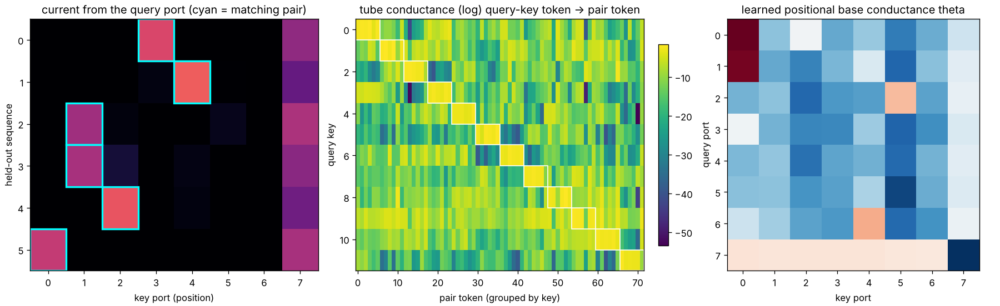
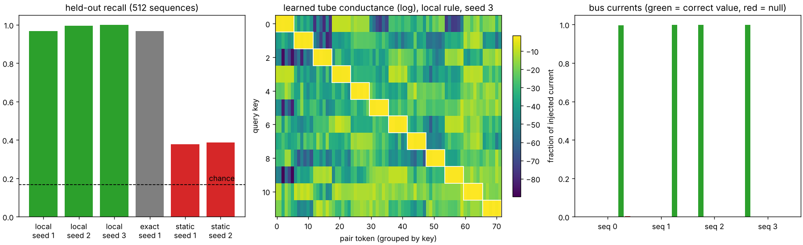

# Limasieni — can a slime mold grow a transformer's attention?


*Limasieni* is Finnish for slime mold.

A tiny transformer is trained on three toy tasks. A *Physarum*-style flow network
(tubes that carry current and adapt their conductance) is then asked to produce the
same attention matrix. One layout grows it from a uniform mesh with a purely local
rule and the transformer still answers correctly with the grown matrix. The classic
layout provably cannot, and the reason is two theorems about electrical networks.

Toy scale: 8 tokens, vocabulary 8, one attention head. Numpy + autograd, CPU only.

```
pip install numpy scipy matplotlib autograd
python g1_train_teacher.py     # train the teacher transformers (~6 min)
python g2_fit_layouts.py       # how well can each network layout copy the matrix?
python g4_grow.py              # grow the two-port network with the local rule
python g6_anneal.py            # unsupervised Physarum on the transformer's attention
python g7_one_network.py       # one grown network for all inputs
python g9_local_recall.py local 1   # recall by a circuit alone, local rule (~35 s)
python g5_end_to_end.py single 600 2   # train the transformer WITH slime attention
python make_figures.py
python gui.py                  # watch it grow
python -m unittest discover -s tests -v
```

## The one identity

Inject one unit of current at a node that is connected to grounded nodes through
parallel conductances `C_j`. Current divides in proportion to conductance:
`I_j = C_j / sum_k C_k`. With `C_j = exp(q·k_j / sqrt(d))` that is exactly softmax.

**Softmax attention is current division.** A query is a food source, each key is a
grounded sink, and the attention weights are the fraction of the food that reaches
each sink. `test_softmax_is_grounded_current_division` checks it to 1e-7 (the gap
scales as 1/g with the sink conductance g). The identity is elementary; the
experiments are about what follows from it.

## Two layouts

**Two-port** (`two_port_attention`): every token owns a *query port* (food source,
no sink) and a *key port* (drains to ground through sink `g`). Tubes `C_ij` connect
query `i` to key `j`.

**Single graph** (`single_graph_attention`): the classic Physarum picture. One node per
token, and that node is both where food is injected and where it is consumed.
`A = (L + G)^-1 G`, with `L` the tube Laplacian and `G = diag(g)`. A *valves* variant
allows one-way tubes (non-symmetric `L`, an absorbing random walk).

### Why the single graph cannot be attention

For reciprocal (symmetric) tubes, `K = (L+G)^-1` is symmetric, so:

1. **Detailed balance**: `g_i A_ij = g_j A_ji`. The network can only produce
   *reversible* matrices. Measured by the entropy production
   `sigma = sum pi_i A_ij log(pi_i A_ij / pi_j A_ji)`, zero iff reversible.
2. **Maximum principle**: the potential from a unit injection at `i` is highest at
   `i`, so `K_ii >= K_ij`. After reweighting by the stationary distribution, current
   always leaves *preferentially where it entered*. A head that looks away from its
   own token is forbidden.

Both facts are standard (reversible Markov chains; discrete harmonic functions).
The new part here is measuring them on a trained transformer's heads.

## Results

### G1 — teacher transformer (softmax)
Held-out accuracy 1.000 on all three tasks.

| task | what the head learned |
|---|---|
| mirror `y_i = x_{n-1-i}` | a near-permutation onto the reflected position |
| shift `y_i = x_{i-1}` | a directed cycle onto the previous position |
| dup `y_i = 1 if x_i occurs elsewhere` | attend to the *other* copy of your token; diffuse if you have none |

### G2/G3 — best possible copy of the teacher's matrix (exact L-BFGS fit, 24 inputs each)

KL(teacher ‖ network), lower is better. Uniform attention scores 1.48 / 1.40 / 0.67.

| task | sigma (irreversibility) | rows violating max principle | single graph | valves | two-port |
|---|---|---|---|---|---|
| mirror | 0.012 | 100% | 0.607 | 0.606 | 0.0002 |
| shift | 3.156 | 100% | 1.201 | 0.989 | 0.0001 |
| dup | 0.012 | 62% | 0.158 | 0.155 | 0.00003 |

- Mirror and dup are nearly reversible but still fail, so the **maximum principle** is
  the binding constraint. The best single-graph copy of mirror splits each row roughly evenly
  between the token itself and its mirror partner: the two nodes get shorted together.
- One-way valves barely help (shift 1.20 → 0.99, mirror unchanged). The obstruction
  is a node having to be both the place current enters and the place it leaves. That
  is the physical reason attention needs separate query and key roles.
- The two-port layout copies all three essentially exactly.

### G4 — growing the two-port network with a local rule

Start: every tube equal. Rule, per tube, using only that tube's own pressure drop:

```
free   : food injected at one query, flow settles
nudged : same, plus a weak pull (beta) of each key sink toward the teacher's uptake
dlogC  = lr * [ dv_free^2 - dv_nudged^2 ] / (2 beta)     summed over the 8 food sources
```

This is equilibrium propagation / coupled learning for a resistor network (Scellier &
Bengio 2017; Kendall et al. 2020; Stern et al. 2021). It matches the exact gradient of
the squared uptake error with cosine 0.99999 (`test_local_rule_is_the_gradient`).

| task | KL local rule | KL exact gradient | transformer accuracy with GROWN matrix | with uniform matrix | tubes pruned below 1% |
|---|---|---|---|---|---|
| mirror | 0.0055 | 0.0055 | **1.000** | 0.302 | 88% |
| shift | 0.0042 | 0.0042 | **1.000** | 0.344 | 88% |
| dup | 0.0032 | 0.0033 | **1.000** | 0.396 | 50% |

12 held-out inputs per task, 1500 growth steps. "Accuracy with grown matrix" replaces
the transformer's own attention by the slime network's current split for that input
and runs the rest of the trained transformer unchanged.

### G6 — unsupervised Physarum on the transformer's own attention

The Tero et al. adaptation rule in its power-law form, `dC/dt = |Q|^mu - C`, on a grounded two-port network, started from the
teacher's attention (100 inputs per task):

| mu | regime | mirror | shift | dup |
|---|---|---|---|---|
| 0.7 | loops, flattens to uniform | 0.295 | 0.309 | 0.376 |
| 1.0 | every attention matrix is a fixed point | 1.000 | 1.000 | 1.000 |
| 1.5 | trees, hardens to argmax | 1.000 | 1.000 | 0.649 |

Softmax attention is a neutral fixed point of Physarum adaptation. The tree regime
keeps pointer tasks (mirror, shift) intact and breaks the task that needs soft,
superposed attention (dup).

### G5 — slime attention trained inside the transformer, end to end

| attention inside the transformer | mirror | shift | dup |
|---|---|---|---|
| softmax (teacher, 1200 steps) | 1.000 | 1.000 | 1.000 |
| two-port network (600 steps, 1 seed) | 1.000 | 1.000 | 1.000 |
| single graph (seeds 1, 2) | 1.000, 1.000 (1200 steps) | 0.743, 0.875 at 600 steps; 0.972 at 2500 steps (seed 1) | 0.999, 0.993 (600 steps) |

Held-out accuracy on 512 sequences. The physics forbids the single graph from *copying*
the teacher's matrix, but it does not stop the transformer from solving the task with a
*different* matrix: the MLP sees the residual stream and can remove a token's own
contribution. The cost shows up on the one irreversible task: shift learns far more
slowly (the softmax teacher was already at 100% at its first checkpoint, step 400) and
was still at 97% after 2500 steps. The valves layout was not trained end to end.

### G7 — ONE grown network for ALL inputs

G4 grew a fresh network for every sequence. Here a single two-port network is grown
once (same local rule, update summed over 100 training sequences), frozen, and placed in
the teacher transformer for 512 sequences it never saw.

| task | teacher's own attention | one static grown network | KL teacher vs static | content share of the head |
|---|---|---|---|---|
| mirror | 1.000 | **1.000** | 0.021 | 0.5% |
| shift | 1.000 | **1.000** | 0.025 | 0.7% |
| dup | 1.000 | 0.403 | 0.650 | 62% |

`content share = mean ||A_input - mean A||^2 / ||A_input||^2`. Mirror and shift heads are
almost purely positional, so one fixed grown network serves every input. The teacher's dup
head depends on token content, so a fixed current split cannot replace it *inside the frozen
teacher* (0.40 is no better than uniform attention, 0.396).

### G8 — can the medium route by content without query/key projections?

Two new attention kinds in `transformer.py`, both two-port networks with finite sinks:

- `static`: tube conductances are learned positional constants only. No content at all.
- `window`: same, but every tube is a *window element* that conducts best when the bias
  voltages at its two ends match. A token's content enters only as a learned bias voltage
  on its own ports (the operating point); the attention signal sees the small-signal
  conductance `C_ij = exp(theta_ij - (b_i - b_j)^2 / w^2)`. No Wq, Wk, no dot products.
- `window4`: four bias pins per port; each tube is a series chain of four window elements,
  so resistances add: `C_ij = 1 / sum_k exp(d_k^2 / w^2)`.

**First finding: dup was the wrong test.** Trained end to end, `static` attention solves
dup at 0.9998 (800 steps) and `window` at 0.9988. Uniform-ish attention delivers the bag of
tokens, and the MLP checks whether its own token occurs twice. Dup needs content routing
only to satisfy the *frozen teacher's* MLP, not to solve the task. So G7's dup failure says
"this teacher routes by content", not "the task requires content routing".

**The real content test: recall.** Seven `(key, value)` pair tokens with distinct keys,
then a query key; the answer is the queried key's value (12 keys, 6 values, 84-token
vocabulary). Width is cut to d = 16 so a static bag of 72 possible pair tokens cannot be
stored losslessly. Chance = 1/6.

| attention inside the transformer | recall held-out accuracy (512 sequences) |
|---|---|
| softmax (Wq, Wk dot products) | 1.000 (100% by step 900) |
| `static` positional tubes, no content | 0.428, 0.396 (seeds 1, 2) |
| `window`, one bias pin | 0.723 |
| `window4`, four pins in series, broad initial width (w = 4) | **1.000, 1.000** (seeds 1, 2; 100% by step 1500) |
| `window4`, narrow initial width (w = 1) | 0.549 |



The trained `window4` network (`g8_inspect.py`, seed 1): the tube conductance between each
query-key token and the 72 pair tokens is block-diagonal. Query key *k* matches exactly the
six pair tokens carrying key *k*. Current from the query port lands on the matching pair;
the remainder stays on the query's own key port (self-match cannot be removed by bias, only
damped by the learned positional term).

So one fixed network, whose input only sets the operating point of its ports, routes by
content well enough to solve recall perfectly, while the same network without the bias
dependence stays near 40%.

Caveats:
- It is trained **end to end by backprop**, not grown by the local free/nudged rule.
  G9 removes that caveat for the routing circuit.
- A window tube is a distance kernel. Distance-based attention exists in ML; what is new
  here is only that a series chain of bias-matched elements gives it as small-signal
  physics, with one shared bias table for both roles (no separate query and key maps).
- It is sensitive to the starting width: too narrow and distant pairs feel no gradient.
- Two seeds, toy scale.

### G9 — recall by a circuit alone, learned by a local rule

G8 still trained a whole transformer by backprop. G9 drops everything except the circuit
(`recall_circuit.py`):

- each token has a query port and a key port; tubes are four-pin window chains as in G8;
- each key port drains into a **value bus**: pair tokens into the bus of their value,
  the query token into a null bus;
- one unit of current is injected at the query port; the answer is the bus that
  receives the most current.

No embeddings, no value projection, no MLP. The only learned things are the tube
positional terms `theta` (8x8), four bias pins per token value, and the window width.

Learning is centred equilibrium propagation. Free phase: inject and settle. Nudged
phases: pull the bus currents weakly toward the target (+beta and -beta). Each tube uses
only its own pressure drops, `dL/dC_e = [dv_e(+beta)^2 - dv_e(-beta)^2] / (4 beta)`, and
each window element turns that into a nudge for the two pins it touches. Given the bias
voltages the circuit is linear in the signal, so this is exact EP:
`test_local_rule_equals_exact_gradient_for_every_parameter` gives cosine > 0.9999 for
theta, the pins and the width.

| arm | held-out recall (512 sequences) |
|---|---|
| **local rule**, seeds 1, 2, 3 | **0.967, 0.996, 1.000** |
| exact gradient, seed 1 (same batches) | 0.967 |
| local rule, positional tubes only (no content) | 0.379, 0.387 |
| chance | 0.167 |



- The local rule and the exact gradient land on the same 0.967 for seed 1, so that
  plateau is the loss landscape, not the rule: three query keys (4, 6, 9) are left with
  pin clusters that are not fully separated from their neighbours.
- The content-free circuit beats chance only by voting for the value that occurs most
  often among the seven pairs.
- In the trained circuit (seed 3) almost all injected current lands on the correct
  value bus and almost none on the null bus; the tube map is block-diagonal, one block
  per key.
- Training took about 35 seconds on one CPU core here (3000 steps, batch 32).

**What is local and what is not.** Every tube and window element computes its update
from its own voltages. The pins of all ports showing the same token value share one
register, so a pin's update is summed over every place that token value appears: weight
sharing, like a convolution kernel, and the one step that is not spatially local. The
target is supplied from outside during the nudged phase, as in all supervised learning.

## Ledger

**Verified**
- Softmax = current division in a grounded two-port network (exact in the limit, 1/g error).
- Single-graph reciprocal networks obey detailed balance and the maximum principle; both
  are checked numerically and both are violated by every trained head here.
- The local free/nudged tube rule is the gradient (cosine 0.99999).
- A uniform two-port mesh grown with that rule reproduces each head's matrix closely
  enough that the trained transformer stays 100% correct on the tested inputs.

**Not claimed**
- G4's grown network copies the matrix **for one input at a time**. G7 shows one frozen
  network does serve every input when the head is positional (mirror, shift); a
  content-dependent head needs the input to change the operator, which is G8's question.
- The local rule is known theory (equilibrium propagation / coupled learning); it is
  used here, not invented.
- The two-port network has 64 free tube conductances for an 8x8 matrix, so G2/G4 show
  that the layout *can* hold the operator, not that it finds a compact one.
- G5's `two_port` kind still builds conductances as `exp(q·k)` from the transformer's own
  Wq, Wk. It moves softmax into a circuit; it does not remove content matching. G8's
  `window` kinds are the attempt to remove it.
- G6 applies the row-normalised (grounded-limit) update directly, not a finite-sink
  circuit solve at every step.
- Analog hardware attention already exists: dot products by Kirchhoff current summation in
  gain-cell arrays (Leroux et al., Nature Computational Science 2025, arXiv 2409.19315).
  The question here is narrower: what a *self-growing* flow network can and cannot carry.
- One head, 8 tokens, toy tasks. Nothing here is evidence about large models or brains.

## Files

| file | what |
|---|---|
| `kirchhoff.py` | both layouts, softmax, entropy production, maximum-principle diagnostic |
| `transformer.py` | tiny one-head transformer with pluggable attention (softmax / single / valves / two_port / static / window / window4) and tasks mirror, shift, dup, recall |
| `physarum.py` | free/nudged potentials, local rule, gradient check, growth loop |
| `g1`–`g7` scripts | the gates above (G8 runs through `g5_end_to_end.py KIND STEPS SEEDS TASK`), results in `results/` |
| `g8_inspect.py` | trains window4 on recall, saves it, draws the learned tube conductances |
| `recall_circuit.py` | G9's pure circuit: window tubes, value buses, local free/nudged rule, exact-gradient check |
| `g9_local_recall.py`, `g9_figure.py` | G9 arms (`local` / `exact` / `static`, seed, steps) and its figure |
| `gui.py` | live growth: tubes, flow from a chosen query, teacher vs slime matrices, KL curve |
| `tests/` | the identity, conservation, the two theorems, the gradient check |
